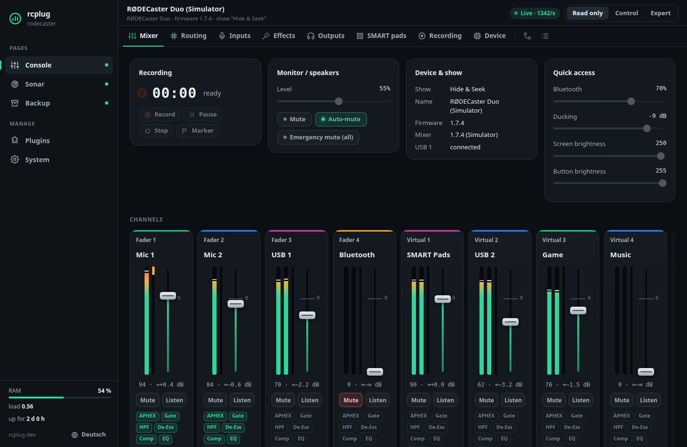

# rcplug

**Eine Plugin-Plattform für den RØDECaster Duo: ein kleiner Host auf dem Gerät, der
Plugins startet und überwacht und ihre Weboberflächen auf einer Seite im Browser
bündelt. Die Firmware fasst er nie an.**

Mit dabei ist die **Konsole**: das ganze Mischpult im Browser. Kanäle mit
Live-Pegeln, Fader, Mute und Listen, Bearbeitung, Routing-Matrix, Eingänge, Ausgänge,
Effekte, SMART Pads, Aufnahme, Systeminfos, ein Bildschirmspiegel und ein Explorer für
den kompletten Gerätezustand. Nach der Installation ist sie **nur lesend**; Steuerung
lässt sich stufenweise zuschalten.

Weitere Plugins wie **Sonar** (aus welcher Richtung kommt ein Geräusch?) liegen in
[rcplug-plugins](https://github.com/Hustenreizjuengling/rcplug-plugins). Ein eigenes Plugin braucht
nur einen Ordner mit `plugin.json` und einem Programm in beliebiger Sprache; für Go gibt
es in diesem Repository ein SDK. Einstieg: die [Plugin-Anleitung](docs/plugin-guide.md),
dazu ein [Kochbuch](docs/cookbook.md) und die [Schnittstellen-Referenz](docs/plugin-api.md)
(alle Englisch). Was als Nächstes kommt: [Roadmap](docs/roadmap.md).



> **Stand: früh und inoffiziell.** Alles wurde **offline** getestet: gegen einen
> Simulator, der einen echten Duo-Gerätezustand (Firmware 1.7.4) abspielt, mit den
> arm64-Programmen unter QEMU und installiert in die Original-Firmware 1.7.6 und 1.7.3.
> **Erster Test an einem echten Duo (Firmware 1.7.6):** Flashen, SSH, Installer,
> In-App-Updates, Dashboard und Plugins funktionieren, und die Konsole bedient das
> Pult über seine Tasten und zeigt seinen Bildschirm. Ihr vollständiges Abbild des Pults
> kommt noch nicht ans Mischpult: Es bedient nur einen Client gleichzeitig, und den
> belegt der Bildschirm des Geräts; das wird umgebaut
> ([docs/device-notes.md](docs/device-notes.md#first-test-on-a-real-duo), Englisch). Die
> Konsole nimmt dem Bildschirm nie den Platz weg. Nach der Installation ist sie nur lesend.
>
> rcplug steht in keiner Verbindung zu RØDE. Nutzung auf eigene Gefahr; bitte den
> Haftungsausschluss unten lesen.

English: [README.md](README.md)

## ⚠ Haftungsausschluss: Nutzung auf eigene Gefahr

rcplug, seine Plugins und Werkzeuge sind **inoffizielle, experimentelle Software** und
werden „wie besehen“ **ohne jede Gewährleistung** bereitgestellt (siehe
[MIT-Lizenz](LICENSE)). Für den SSH-Zugang wird eine veränderte Firmware auf den
RØDECaster geflasht. Das Flashen, das Installieren von Software auf dem Gerät und das
Ändern seiner Einstellungen **kann das Gerät unbrauchbar machen („bricken“)**,
Einstellungen oder Aufnahmen löschen und **die Garantie erlöschen lassen**. RØDE
unterstützt so veränderte Geräte nicht. Alles, was du mit diesem Projekt machst,
geschieht **in deiner eigenen Verantwortung**: Die Autoren haften nicht für Schäden an
deinem Gerät, deinen Daten oder deinen Produktionen. Nicht während einer Sendung
einsetzen, die nicht ausfallen darf.

## Unterstützte Geräte

| Gerät | Stand |
|---|---|
| RØDECaster Duo, Firmware 1.7.x | Läuft auf einem echten Duo (1.7.6): Host, Dashboard, In-App-Updates und Plugins; die Konsole bedient die Tasten des Geräts und spiegelt seinen Bildschirm. Ihr Abbild des ganzen Pults kommt noch nicht ans Mischpult (es bedient nur den Bildschirm des Geräts); wird umgebaut. |
| RØDECaster Pro II | Wird erkannt und **nur lesend** angezeigt. Steuerung braucht ein geprüftes Profil, siehe [docs/adding-a-model.md](docs/adding-a-model.md). |
| Andere / unbekannt | Nur lesend. |

## Ohne Gerät ausprobieren

Benötigt Go 1.22 oder neuer.

```bash
make run-local                 # Host, Konsole und Beispiele auf http://127.0.0.1:8080
                               # (die Konsole spricht mit einem simulierten Duo)
go run ./cmd/console --sim     # nur die Konsole, auf http://127.0.0.1:8082
```

Liegt [rcplug-plugins](https://github.com/Hustenreizjuengling/rcplug-plugins) neben diesem
Repository, startet `make run-local` dort dasselbe mit dessen Plugins.

## Auf dem Gerät installieren

Installieren, Aktualisieren und Entfernen geht vom Computer aus mit
[rcplug-toolkit](https://github.com/Hustenreizjuengling/rcplug-toolkit): ein Setup-Fenster für
Windows, macOS und Linux oder ein Skript. Es bringt auch SSH auf den Duo, der ab Werk
keinen Zugang hat: Du fügst einmalig deinen eigenen Schlüssel in die Firmware ein
([enable-ssh.md](https://github.com/Hustenreizjuengling/rcplug-toolkit/blob/main/docs/enable-ssh.md),
Englisch).

Die [Releases](../../releases) dieses Repositorys enthalten das Gerätepaket, das das
Toolkit installiert: `rcplug-<version>-aarch64.tar.gz` (Host, Konsole,
Geräte-Installer) und die Beispiel-Plugins. Danach `http://<geräte-ip>:8080/` öffnen;
die Konsole ist die Startseite. Die Vorabversion *Development build* enthält den
neuesten Stand des Codes, zum Testen.

**Was wo landet:** Host, Plugins und deren Daten kommen in ein Verzeichnis,
`/usr/local/rcplug`. Außerdem legt rcplug ein Startskript `/etc/init.d/rcplug` mit
Autostart-Links und eine PID-Datei in `/var/run` an; die Logs bleiben im
Installationsverzeichnis (`logs/`). Sonst wird am Gerät nichts verändert, und
Deinstallieren entfernt alles davon. Der Host läuft als **root** mit niedrigster
CPU-Priorität, Audio hat also immer Vorrang. Ein Update von rcplug behält die
Einstellungen. Ein **Firmware-Update** schreibt eine frische Root-Partition, und der Duo
hat keinen anderen Ort, der das übersteht: rcplug, seine Einstellungen und dein
SSH-Schlüssel sind danach weg.

**Updates:** Einmal installiert, aktualisiert sich rcplug samt Plugins aus dem
Dashboard (**System → Updates**): Es fragt GitHub nur, wenn du suchst, zeigt die
Versionshinweise und installiert nur signierte Releases, die du anklickst. Startet eine
neue rcplug-Version nicht, kommt die vorherige von selbst zurück. Siehe
[docs/updates.md](docs/updates.md) (Englisch).

## Wenn etwas schiefgeht

Auf der Seite **System** im Dashboard gibt es den Knopf **Diagnose herunterladen**. Das
ZIP enthält die Logs des Hosts und aller Plugins (auf dem Gerät dauerhaft gespeichert,
auch über Neustarts hinweg), Versionen, Gerätewerte, Prozesse und Kernel-Log, die
Verbindungsstatistik der Konsole und eine bereinigte Kopie des Pult-Zustands.
Passwörter, PINs, Schlüssel und die Werte deiner Einstellungen sind maskiert (URLs bis auf
den Host). Häng es an einen Fehlerbericht.
Antwortet die Weboberfläche nicht mehr, holt das Toolkit dasselbe Paket per SSH.

## Die Konsole bedienen

- **Nur lesen · Steuern · Experte** oben rechts legt fest, was die Konsole ändern darf.
  *Nur lesen* ist nach der Installation eingestellt; die gewählte Stufe bleibt über
  Neustarts erhalten. *Steuern* erlaubt die alltägliche Bedienung, jede mit ihrem
  gültigen Wertebereich. *Experte* erlaubt fast jede Eigenschaft im Explorer.
- Manches ist nie erlaubt: Firmware-Update, Zurücksetzen, Ausschalten, Speicher löschen
  oder formatieren, Netzwerk- und Kontoeinstellungen. Passwörter und Schlüssel verlassen
  das Gerät nie.
- Physische Fader sind nicht motorisiert: Auf *Steuern* werden sie angezeigt, aber
  nicht fernbewegt. *Experte* erlaubt es, doch der echte Fader bleibt, wo er ist, und
  übernimmt wieder, sobald ihn jemand anfasst.
- Der Reiter **Protokoll** listet die letzten Änderungen, die die Konsole ans Gerät
  geschickt hat (im Speicher, bis die Konsole neu startet).
- Für Änderungen lässt sich eine **PIN** setzen (System → Konsole). Sie schützt nur
  Änderungen am Pult: Jeder in deinem Netzwerk kann die Konsole weiterhin *ansehen*
  (auch Details wie Seriennummer und Netzwerkadressen) und im Dashboard Plugins starten
  oder stoppen. rcplug hat keine Benutzerkonten und ist für ein vertrauenswürdiges
  Heimnetz gedacht.

Mehr dazu: [docs/safety.md](docs/safety.md) (Englisch).

## Dokumentation

Die ausführliche Dokumentation ist auf Englisch, siehe die Tabelle in
[README.md](README.md#documentation). Die Oberflächen gibt es auf Deutsch und Englisch
(Umschalter oben rechts).

## Mitmachen

Fehlerberichte, Geräteberichte und Pull Requests sind willkommen, siehe
[CONTRIBUTING.md](CONTRIBUTING.md). Sicherheitsprobleme bitte vertraulich melden, wie in
[SECURITY.md](SECURITY.md) beschrieben.

## Lizenz

MIT, siehe [LICENSE](LICENSE). Daten und Quellen Dritter:
[THIRD_PARTY_NOTICES.md](THIRD_PARTY_NOTICES.md). RØDE und RØDECaster sind Marken ihres
Inhabers und werden hier nur verwendet, um zu beschreiben, womit rcplug arbeitet.
