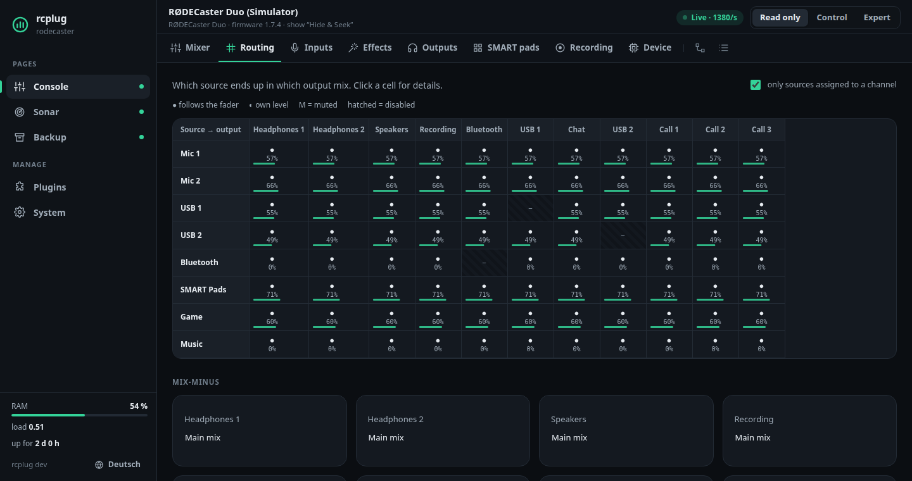

# rcplug

**A plugin platform for the RØDECaster Duo: a small host that runs on the device,
starts and supervises plugins, and gathers their web interfaces on one page in your
browser. It never touches the firmware.**

rcplug ships with the **console**: the whole mixer in the browser. Channels with live
meters, faders, mute and listen, processing, the routing matrix, inputs, outputs,
effects, SMART pads, the recorder, system information, a screen mirror and an
explorer for the complete device state. A fresh install is **read-only**; you can
switch on control in steps.

More plugins, such as **Sonar** (which direction does a sound come from?), live in
[rcplug-plugins](https://github.com/Hustenreizjuengling/rcplug-plugins). Writing your own takes a
folder with a `plugin.json` and a program in any language; for Go there is an SDK in
this repository. Start with the [plugin guide](docs/plugin-guide.md).


> **Status: early and unofficial.** Everything has been tested **offline**: against a
> simulator that replays a real Duo state capture (firmware 1.7.4), with the arm64
> binaries under QEMU, and installed into the stock firmware images 1.7.6 and 1.7.3.
> **It has not run on a physical device yet.** What only a running device can show is
> listed in [docs/device-notes.md](docs/device-notes.md). This is why a fresh install is
> read-only, and why the console steps back if it notices it might disturb the
> device's own screen.
>
> rcplug is not affiliated with or endorsed by RØDE. Use it at your own risk; read the
> disclaimer below.

Deutsch: [README.de.md](README.de.md)

## ⚠ Disclaimer: use at your own risk

rcplug, its plugins and its tools are **unofficial, experimental software**, provided
"as is" **without any warranty** (see the [MIT license](LICENSE)). Getting SSH onto
the RØDECaster means flashing a modified firmware. Flashing, installing software on the
device and changing its settings **can make the device unusable ("brick" it)**, lose
settings or recordings and **void your warranty**. RØDE does not support devices
changed this way. Whatever you do with this project, you do **on your own
responsibility**: the authors accept no liability for damage to your device, your
data or your productions. Do not use it during a show that must not fail.

## Supported devices

| Device | Status |
|---|---|
| RØDECaster Duo, firmware 1.7.x | Developed against a real state capture and the stock firmware; mirror and control implemented. Waiting for its first test on hardware. |
| RØDECaster Pro II | Recognised and shown **read-only**. Control needs a verified profile; see [docs/adding-a-model.md](docs/adding-a-model.md). |
| Other / unknown | Shown read-only. |

## Try it without a device

You need Go 1.22 or newer.

```bash
make run-local                 # host, console and examples on http://127.0.0.1:8080
                               # (the console talks to a simulated Duo)
go run ./cmd/console --sim     # only the console, on http://127.0.0.1:8082
```

With [rcplug-plugins](https://github.com/Hustenreizjuengling/rcplug-plugins) checked out next to this
repository, `make run-local` there starts the same with its plugins.

## Install on the device

Installing, updating and removing is done from your computer with
[rcplug-toolkit](https://github.com/Hustenreizjuengling/rcplug-toolkit): a setup window for Windows,
macOS and Linux, or a script. It also gets SSH onto the Duo, which has none out of the
box: you add your own key to the firmware once
([enable-ssh.md](https://github.com/Hustenreizjuengling/rcplug-toolkit/blob/main/docs/enable-ssh.md)).

This repository's [releases](../../releases) contain the device package the toolkit
installs: `rcplug-<version>-aarch64.tar.gz` (host, console, device installer) and the
example plugins. Then open `http://<device-ip>:8080/`; the console is the start page.

**What gets installed where:** the host, its plugins and their data go into one
directory, `/usr/local/rcplug`. Besides that, rcplug adds a start script
`/etc/init.d/rcplug` with its autostart links and a PID file in `/var/run`; the logs
stay in the install directory (`logs/`). Nothing else on the device is changed, and
uninstalling removes all of it. The host runs as **root** at the lowest CPU priority,
so audio always comes first. Updating rcplug keeps its settings.

**Updates:** once installed, rcplug updates itself and its plugins from the dashboard
(**System → Updates**): it checks GitHub only when you ask, shows the release notes and
installs only signed releases you click. If a new version of rcplug does not start,
the previous one comes back by itself. See [docs/updates.md](docs/updates.md). A **firmware update**
writes a fresh root partition, and the Duo has no other place that survives it:
rcplug, its settings and your SSH key are gone afterwards.

## When something goes wrong

The dashboard's **System** page has a **Download diagnostics** button. The zip contains
the logs of the host and all plugins (kept on the device across reboots), versions,
the device's vitals, processes and kernel log, the console's connection statistics
and a sanitized copy of the desk state. Passwords, PINs, keys and the values of your
settings are masked (URLs down to their host). Attach it
to a bug report. If the web interface does not respond, the toolkit gets the same
bundle over SSH.

## Using the console

- **Read only · Control · Expert** at the top right sets what the console may change.
  *Read only* is the default on a fresh install; the level you choose is kept across
  restarts. *Control* allows everyday operation, each control with its valid range.
  *Expert* allows almost every property in the explorer.
- Some things are never allowed: firmware update, reset, power off, deleting or
  formatting storage, network and account settings. Passwords and keys never leave
  the device.
- Physical faders are not motorised: at *Control* they are shown but not moved
  remotely. *Expert* allows it, but the real fader stays where it is and takes over
  again as soon as someone touches it.
- The **Log** tab lists the last changes the console sent to the device (kept in
  memory until the console restarts).
- You can set a **PIN** for changes (System → Console). The PIN protects changes to the
  desk only: everyone on your network can still *see* the console (including details
  like the device's serial number and network addresses) and start or stop plugins on
  the dashboard. rcplug has no user accounts and is made for a home network you trust.

More: [docs/safety.md](docs/safety.md).



## Documentation

| | |
|---|---|
| [Architecture](docs/architecture.md) | How the host, the plugins and the device fit together; the host's API |
| [Configuration](docs/configuration.md) | All flags, environment variables and settings files |
| [Developing plugins](docs/plugin-guide.md) | A complete plugin step by step, from the first page to signed updates |
| [Plugin cookbook](docs/cookbook.md) | Recipes: follow the desk, mute, markers, pads, webhooks, audio, diagnostics, … |
| [Plugin interface](docs/plugin-api.md) | The reference: manifest, process, environment, HTTP, dashboard, host API, SDK |
| [Updates](docs/updates.md) | In-app updates: using them, how they are secured, publishing signed releases |
| [Console API](docs/console-api.md) | Reading and controlling the desk over HTTP from your own code |
| [Protocol](docs/protocol.md) | The desk's control port (JUCE ValueTree over TCP) |
| [Safety](docs/safety.md) | What protects the device and your network |
| [Device notes](docs/device-notes.md) | What the firmware has, what still needs a real device |
| [Adding a model](docs/adding-a-model.md) | Capturing a device state and making a model controllable |
| [Development](docs/development.md) | Building, testing, repository layout, the three repositories |
| [Roadmap](docs/roadmap.md) | What comes next, and plugins worth building |

## Contributing

Bug reports, device reports and pull requests are welcome. See
[CONTRIBUTING.md](CONTRIBUTING.md). Please report security problems privately, as
described in [SECURITY.md](SECURITY.md).

## License

MIT, see [LICENSE](LICENSE). Third-party data and sources:
[THIRD_PARTY_NOTICES.md](THIRD_PARTY_NOTICES.md). RØDE and RØDECaster are trademarks of
their owner and are used here only to describe what rcplug works with.
