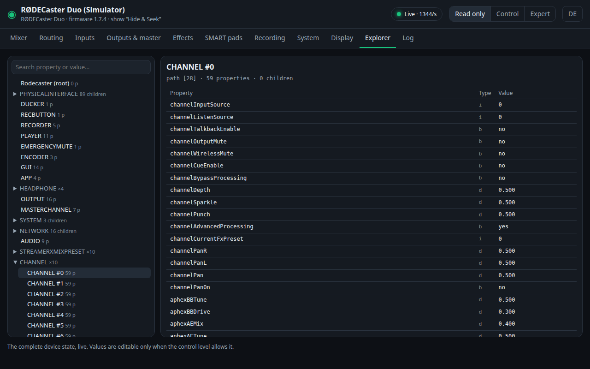

# Architecture

rcplug adds software to the RØDECaster without touching its firmware. The device runs
an ordinary embedded Linux (aarch64, SysV init) with SSH access. rcplug is a set of
statically linked Go programs that are copied there and started as a service.

```
 Browser (PC, phone)                    RØDECaster (aarch64 Linux)
┌───────────────────┐  HTTP :8080   ┌─────────────────────────────────────────────────┐
│ dashboard         │◀────────────▶│ rcplugd  (plugin host, nice 19)                 │
│  ├ Console        │               │  ├ loads plugins/*/plugin.json                  │
│  ├ Sonar          │               │  ├ starts and supervises one process per plugin │
│  ├ Plugins        │               │  ├ reverse proxy /plugins/<name>/ → 127.0.0.1   │
│  └ System         │               │  └ dashboard (embedded web UI)                  │
└───────────────────┘               │                                                 │
                                    │ console  127.0.0.1:91xx ──TCP 2345──▶ rc_audio_mixer
                                    │   mirror of the state tree        (the device's  │
                                    │   write policy, audit log          own screen is │
                                    │   meters (shared memory)           a client too) │
                                    │ sonar    127.0.0.1:91xx ◀── JACK via loopback    │
                                    │ your plugin …                                    │
                                    └─────────────────────────────────────────────────┘
```

## The host: `rcplugd`

`cmd/rcplugd` with the logic in `internal/host`.

- **Discovery.** Every directory under `<root>/plugins/` with a `plugin.json` is a
  plugin. The directory name is its id. Invalid manifests are skipped and listed on
  the dashboard. A rescan (dashboard button, `POST /api/reload` or `SIGHUP`) starts
  added plugins, stops removed ones and reads changed manifests; a running plugin keeps
  its process until it is restarted.
- **Supervision.** Each enabled plugin runs in its own process group. If it exits,
  it is restarted after a pause that doubles from 1 s to about 30 s; a process that
  ran for over a minute starts again at 1 s. Stopping sends SIGINT to the group,
  then SIGKILL after 3 s, and whatever is left of the group is removed once the
  plugin has exited. A new start waits until the previous process is gone, so two
  instances never overlap. The last 500 output lines of each plugin are kept for the
  dashboard.
- **Ports.** Plugins with a web UI get a loopback port (from 9100 up) passed as
  `{{port}}` and `RCPLUG_PORT`. They listen on 127.0.0.1 only; the host is the single
  entry point.
- **Proxy.** `/plugins/<name>/…` is forwarded to the plugin with the prefix removed,
  `X-Forwarded-*` headers and `X-Forwarded-Prefix`. Streaming responses (SSE, MJPEG)
  are flushed immediately.
- **State.** The plugins the user started or stopped are stored in
  `<root>/state.json`. The `autostart` field of a manifest is the default for the
  others, so a new version can change it.
- **Leftovers.** The process group of every running plugin is recorded in
  `<root>/.groups`. If rcplugd dies without stopping its plugins, the next start
  removes what is left of those groups (from the same boot, still working in the
  plugins directory) before it starts anything.
- **Dashboard.** `cmd/rcplugd/web` is a single static page. Plugin UIs are shown in an
  iframe; the plugin marked `primary` is the start page.
- **Updates.** On request, `internal/host/update.go` asks GitHub for the latest
  releases of rcplug and of plugins with an update source, checks the signed
  `release.json` and installs what the operator clicks: a plugin by replacing its
  directory, rcplug itself by running the new package's `install.sh` in its own
  session, which replaces and restarts rcplugd and goes back to the previous version
  if the new one does not start. See [updates.md](updates.md).
- **Priority.** The host lowers every thread to nice 19 before starting anything,
  and children inherit it.

### Host API

The dashboard uses a small JSON API; scripts can use it too. Requests that change
something need the header `X-Rcplug: 1`.

| Request | Effect |
|---|---|
| `GET /api/plugins` | `{"plugins": [...], "invalid": [...]}`: each plugin's manifest data, state (`running`, `starting`, `backoff`, `stopped`), PID, restarts and last error; skipped directories with the reason |
| `GET /api/plugins/<name>/logs` | `{"lines": [...]}`: the plugin's last 500 output lines |
| `POST /api/plugins/<name>/enable`, `/disable`, `/restart` | Start (and remember as enabled), stop (and remember as disabled), restart an enabled plugin |
| `POST /api/reload` | Rescan the plugins directory |
| `GET /api/system` | Host name, version, uptime, load, memory, CPU temperature, free storage |
| `GET /api/diagnostics` | The diagnostics bundle (zip) |
| `GET /api/updates` | The last update check: `targets` (`rcplug` and `plugin:<name>`, each with `current`, `latest`, `available`, `notes`, `error`), the running install (`job`), the outcome of the last update of rcplug (`last`), the trusted key ids, whether the daily check is on (`autoCheck`) and how many updates it found (`available`); while an install runs, `job` has `phase`, `done`, `total` and `eta`. No network access |
| `POST /api/updates/check` | Ask GitHub for the latest releases (a second check within 20 s returns the first) |
| `POST /api/updates/auto?on=true\|false` | Switch the daily update check on or off |
| `GET /api/audio`, `GET /api/audio/stream?ports=`, `POST /api/audio/enable?on=` | The shared audio taps: status and ports, a stream for a plugin (its token), the switch; see [plugin-api.md](plugin-api.md#audio) |
| `POST /api/uninstall` | Remove rcplug from the device (`{"confirm": "uninstall"}`), see [safety.md](safety.md#installing-and-removing) |
| `GET /api/processes` | The device's processes with CPU, memory and threads, marked as rcplug's (and which plugin) or RØDE's; see [plugin-api.md](plugin-api.md#host-api) |
| `GET /api/events`, `GET /api/events/stream`, `POST /api/events` | The event bus: the kept events, a live stream (server-sent events), publishing (plugins only, with their token); see [plugin-api.md](plugin-api.md#events) |
| `GET /api/access`, `POST /api/login`, `POST /api/logout`, `POST /api/access/password`, `POST /api/access/reset`, `GET /login` | The optional dashboard password: status (`protected`, `loggedIn`, `reset`), log in (`{"password"}`, sets the session cookie), log out, set, change or remove it (`{"current", "new"}`, `new: ""` removes), and the reset at the device; see [safety.md](safety.md#web-security). With a password set, every other request without a session gets 401 `login_required` (a page: a redirect to `/login`) |
| `POST /api/updates/install?target=<target>` | Install what the last check found for `rcplug` or `plugin:<name>`; 409 while another install runs. See [updates.md](updates.md) |
| `/plugins/<name>/…` | The plugin's own web UI and API, proxied |

### Directory layout on the device

```
<root>/                 /usr/local/rcplug by default
  rcplugd               the host
  rccapture             tool for capturing device states (docs/adding-a-model.md)
  plugins/<name>/       plugin code: plugin.json + executable (replaced on update)
  data/<name>/          plugin data, RCPLUG_DATA_DIR (kept)
  config/<name>.json    operator settings per plugin (kept)
  state.json            plugins the user started or stopped (kept)
  .groups               process groups of running plugins
  logs/                 rcplugd.log, <plugin>.log, rcplugd.out (raw output, e.g. a
                        crash trace); each rotated at 512 KB, one older file kept;
                        update.log and update.result from in-app updates
  .update/              download and unpack area of a running update (removed after)
/etc/init.d/rcplug      start script (SysV)
```

## The console plugin

`cmd/console` wires together these packages:

| Package | Role |
|---|---|
| `internal/rcproto` | Pure protocol code: `juce::var` values, ValueTree nodes, change messages, TCP framing, discovery of the node families (layout), model detection, sanitizing |
| `internal/desk` | The connection to the desk: session handling with full sync and reconnects, the GUI guard, the mirror (a local copy of the tree with epoch and sequence numbers), batched change fan-out to subscribers, JSON encoding with redaction |
| `internal/console` | HTTP API, write policy (levels, deny list, value ranges), PIN, settings, audit log, summary, embedded web UI |
| `internal/hw` | The mixer's meter memory (read-only) and the experimental front-panel emulation |
| `internal/rcsim` | Simulator of the control port for development and tests |



The data flow:

1. `desk.Client` receives a **full sync**: the whole tree (on the Duo about 870 nodes
   with 6900 properties). On a RØDECaster the mixer serves one client, the device's
   own screen, so the client **reads along** with the screen's connection on the
   loopback interface (`internal/desk/tap.go`) and never connects; the full sync comes
   when the screen connects (rcplug starts before it at boot). Against the simulator
   or through an SSH tunnel it connects to the port itself.
2. Every later message is a small change (property changed, child added, …). The
   client applies it to the `desk.Mirror`.
3. Every 60 ms the console sends the changes collected since the last batch to all
   browsers over Server-Sent Events, keeping only the latest value per property.
4. A write from the browser is checked by the policy, sent to the desk and applied to
   the mirror at once (the desk does not echo a client's own writes). Reading along
   cannot write: there the device is operated through its front panel (buttons,
   wheel, pads), whose effect the mirror then shows.

Structural changes (a show is loaded, a pad added) change the tree's **epoch**. Paths
are child indices, so a write carries the epoch it was computed against and is refused
if the tree changed in between. Browsers reload the tree when the epoch changes.

### Web UI

`internal/console/web` is plain HTML, CSS and ES modules, embedded with `go:embed`,
with no build step and no third-party code:

| Module | Role |
|---|---|
| `store.js` | the tree, the layout, epoch and sequence; loads and patches it |
| `live.js` | the SSE connection, reconnects with backoff, reloads on epoch changes |
| `scope.js` | lifetime of a view: bindings, timers and streams are released together |
| `policy.js` | mirrors the server's capabilities to enable or disable controls |
| `api.js` | write requests, PIN prompt, error handling |
| `views/*.js` | one module per tab, registered in `views/index.js` |
| `i18n/*.js` | German and English texts |

## Sonar and other plugins

Plugins only talk to the host through HTTP and environment variables. Sonar lives in
[rcplug-plugins](https://github.com/Hustenreizjuengling/rcplug-plugins): it reads stereo audio from
two JACK ports of the desk (bridged through an ALSA loopback, opt-in), with `arecord`,
from a WAV file or a test generator, and serves its own radar page. The examples in
`examples/` are an on-air clock (the result of [plugin-guide.md](plugin-guide.md)), a
recording log, both in Go with the console API, and a shell plugin without a UI.
The interface is described in [plugin-api.md](plugin-api.md).

## Design choices

- **Go standard library only.** One static binary per program, no libc dependency on
  the device's Yocto system, easy cross-compiling and auditing.
- **Processes, not in-process plugins.** A crashing plugin cannot take down the host,
  any language works, and each plugin is limited to what its own process does.
- **Nothing hard-coded about the tree.** Node families are found at run time
  (`rcproto.DiscoverLayout`), so a firmware that reorders the tree still works.
  Model-specific knowledge lives in `rcproto/model.go`.
- **Safe defaults.** Read-only start, a deny list that the expert mode cannot lift,
  no new properties ever created on the desk, and a guard for the device's own screen.
  See [safety.md](safety.md).
- **Updates only on request, only signed.** No background contact with the internet;
  releases must be signed by a key built into rcplugd. See [updates.md](updates.md).
