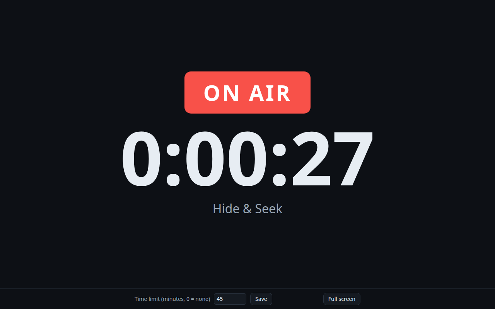

# Developing plugins

This guide builds a complete plugin step by step: **On air**, a big recording clock
for a tablet next to the desk. It shows whether the RØDECaster is recording, for how
long, and warns when a time limit is reached. On the way it covers what most plugins
need: a web page, reading the desk, pushing changes to the browser, a setting, two
languages, tests, installing on the device and publishing updates.

The finished plugin is [`examples/onair`](../examples/onair). The other documents:

| | |
|---|---|
| [plugin-api.md](plugin-api.md) | The reference: everything the host promises a plugin and expects from it |
| [cookbook.md](cookbook.md) | Short recipes for common tasks |
| [console-api.md](console-api.md) | Reading and controlling the desk |



## 1. What a plugin is

- A **directory** with a `plugin.json` and a program. The directory name is the
  plugin's id.
- The host, **rcplugd**, starts the program, restarts it if it crashes, keeps its
  output as a log and stops it with SIGINT.
- A plugin with a **web page** serves HTTP on a loopback port that the host assigns.
  The host makes it reachable at `/plugins/<name>/` and shows it in the dashboard.
- A plugin **never talks to the desk's control port** itself. It asks the console
  plugin, which keeps a mirror of the desk's state and enforces the user's control
  level.
- Any language that runs on aarch64 Linux works. Go is the easiest: one static binary,
  and the [`sdk`](../sdk) package covers the details. Shell and Python work too, see
  [section 12](#12-other-languages).

## 2. Set up

You need Go 1.22 or newer and git. Clone rcplug next to your plugin; it brings the
simulator and a local host to try plugins without a device:

```
work/
  rcplug/     git clone https://github.com/Hustenreizjuengling/rcplug
  onair/      your plugin
```

```bash
cd work/rcplug
make run-local     # dashboard on http://127.0.0.1:8080, the console on a simulated Duo
```

Open the dashboard: the console shows the simulated desk. Stop it with Ctrl+C.

## 3. Create the module and the manifest

```bash
mkdir ../onair && cd ../onair
go mod init example.com/onair
go get github.com/Hustenreizjuengling/rcplug@latest   # the SDK, standard library only
```

To change the SDK and your plugin together, use a workspace instead of a released
version: `cd .. && go work init ./rcplug ./onair`.

`plugin.json` tells the host how to run the plugin:

```json
{
  "$schema": "https://raw.githubusercontent.com/Hustenreizjuengling/rcplug/main/plugin.schema.json",
  "title": "On air",
  "description": "A big on-air clock for a tablet next to the desk, with the recording time and a time limit.",
  "version": "0.1.0",
  "exec": ["./onair", "--addr", "127.0.0.1:{{port}}"],
  "httpProxy": "127.0.0.1:{{port}}",
  "autostart": true,
  "icon": "⏱",
  "translations": {
    "de": {"title": "On Air", "description": "Eine große On-Air-Uhr für ein Tablet neben dem Pult."}
  }
}
```

- `exec` is the command line, run in the plugin's directory. `{{port}}` becomes the
  port the host assigned.
- `httpProxy` says where the web server listens; the host forwards
  `/plugins/onair/…` there. Without it the plugin has no page.
- `autostart` runs the plugin unless the user stops it.
- `$schema` lets editors check the file. The full list of fields is in the
  [reference](plugin-api.md#the-manifest-pluginjson).

## 4. Serve a page

```go
package main

import (
	"embed"
	"flag"
	"io/fs"
	"log"
	"net/http"

	"github.com/Hustenreizjuengling/rcplug/sdk"
)

//go:embed web
var webFS embed.FS

func main() {
	addr := flag.String("addr", sdk.ListenAddr("127.0.0.1:8091"), "listen address")
	flag.Parse()

	ctx, stop := sdk.SignalContext() // cancelled on SIGINT and SIGTERM
	defer stop()

	page, _ := fs.Sub(webFS, "web")
	mux := http.NewServeMux()
	mux.Handle("GET /", sdk.Files(page))

	log.Printf("onair on %s", *addr)
	if err := sdk.Serve(ctx, *addr, mux); err != nil {
		log.Fatal(err)
	}
}
```

Put an `index.html` into `web/` and run `go run .`; the page is at
`http://127.0.0.1:8091/`.

- `sdk.ListenAddr` returns `127.0.0.1:$RCPLUG_PORT` under the host and the default
  when you run the program yourself.
- `sdk.Serve` listens, shuts down gracefully when the context ends, and refuses
  state-changing requests without the `X-Rcplug` header (see step 7).
- `sdk.Files` serves the page so that browsers keep it (they only ask whether it
  changed) and get text compressed. On a RØDECaster every byte to a browser shares the
  CPU's interrupt handling with the device's USB audio, so a page should not send a few
  hundred kilobytes at every visit. Send large JSON with `sdk.WriteBody`, which
  compresses it.
- Everything the program logs ends up in the plugin's log on the dashboard.
- **Use relative URLs in the page** (`api/view`, never `/api/view`). The page is
  served at `/plugins/onair/` behind the host and at `/` when you open the port
  directly.

### Look like the rest of rcplug

`sdk/ui` is the look of rcplug's dashboard and console: a stylesheet with the colours,
type and components (cards, buttons, segmented controls, tabs, switches, sliders,
status pills, banners, tables) and an icon set, about 24 KB together. Serve it next
to your page and your plugin reads as part of the application, also inside the
dashboard's frame:

```go
import "github.com/Hustenreizjuengling/rcplug/sdk/ui"

mux.Handle("GET /ui/", ui.Handler("/ui/"))
```

```html
<link rel="stylesheet" href="ui/rcplug.css">

<main class="page">
  <div class="page-head"><div><h1>On air</h1><p class="lead">Shows when the desk records.</p></div></div>
  <section class="card">
    <div class="card-head"><h2>Recorder</h2><span class="pill ok live">On air</span></div>
    <button class="btn primary"><svg class="i"><use href="ui/icons.svg#record"/></svg>Start</button>
  </section>
</main>
```

The classes are listed at the top of each block in
[`sdk/ui/rcplug.css`](../sdk/ui/rcplug.css), the icons' names in
[`sdk/ui/icons.svg`](../sdk/ui/icons.svg). Inside the dashboard (an iframe) the
dashboard already shows the plugin's name, so a plugin usually leaves out a header of
its own there (`window.self !== window.top`).

## 5. Read the desk

The console plugin offers the desk's state over HTTP; the Go client is
[`sdk/console`](../sdk/console). `Summary` is a compact view with the channels,
the recorder and the pads:

```go
import capi "github.com/Hustenreizjuengling/rcplug/sdk/console"

// View is what the page shows.
type View struct {
	Recording bool   `json:"recording"`
	Paused    bool   `json:"paused"`
	TimeMs    int64  `json:"timeMs"`
	Show      string `json:"show"`
	Desk      string `json:"desk"` // live, offline or unavailable
	LimitMin  int    `json:"limitMin"`
}

func (a *app) watch(ctx context.Context, c *capi.Client, every time.Duration) {
	t := time.NewTicker(every)
	defer t.Stop()
	for {
		s, err := c.Summary(ctx)
		a.change(func(v *View) {
			if err != nil {
				v.Desk = "unavailable"
				return
			}
			v.Recording = s.Recorder.State == 2 // 0 ready, 1 paused, 2 recording
			v.Paused = s.Recorder.State == 1
			v.TimeMs = s.Recorder.TimeMs
			v.Show = s.Show
			v.Desk = "live"
			if s.Stale {
				v.Desk = "offline"
			}
		})
		select {
		case <-ctx.Done():
			return
		case <-t.C:
		}
	}
}
```

and in `main`: `go a.watch(ctx, capi.New(""), 500*time.Millisecond)`.

- `capi.New("")` finds the console through the host (`RCPLUG_HOST_URL`).
- The console may start after your plugin, restart, or lose the desk for a moment.
  Do not exit on errors; show them and keep trying.
- `Stale` means the console shows the last known state while the desk is not
  connected.
- Twice a second is plenty for a clock. For many fast changes, follow the event
  stream instead ([cookbook](cookbook.md#follow-every-change-of-the-desk)).

## 6. Push changes to the browser

Polling from every browser would multiply the work. Server-Sent Events let the plugin
push the view whenever it changes; the host's proxy passes the stream through.

```go
// change applies fn to the view and wakes the browsers if anything changed.
func (a *app) change(fn func(*View)) {
	a.mu.Lock()
	defer a.mu.Unlock()
	old := a.view
	fn(&a.view)
	if a.view == old {
		return
	}
	for ch := range a.subs {
		select {
		case ch <- struct{}{}:
		default: // already woken; it sends the latest view anyway
		}
	}
}

func (a *app) handleEvents(w http.ResponseWriter, r *http.Request) {
	fl, ok := w.(http.Flusher)
	if !ok {
		sdk.Error(w, http.StatusInternalServerError, "streaming is not supported")
		return
	}
	ch := make(chan struct{}, 1)
	a.mu.Lock()
	a.subs[ch] = true
	a.mu.Unlock()
	defer func() {
		a.mu.Lock()
		delete(a.subs, ch)
		a.mu.Unlock()
	}()

	w.Header().Set("Content-Type", "text/event-stream")
	w.Header().Set("Cache-Control", "no-store")
	again := time.NewTicker(25 * time.Second) // keeps idle connections open
	defer again.Stop()
	for {
		raw, _ := json.Marshal(a.snapshot())
		fmt.Fprintf(w, "data: %s\n\n", raw)
		fl.Flush()
		select {
		case <-r.Context().Done():
			return
		case <-ch:
		case <-again.C:
		}
	}
}
```

Register it with `mux.HandleFunc("GET /api/events", a.handleEvents)`. In the page:

```js
const events = new EventSource('api/events'); // reconnects by itself
events.onmessage = (e) => { view = JSON.parse(e.data); draw(); };
```

The page counts the seconds itself between two updates, so the clock runs smoothly
even though the plugin reads the desk only twice a second.

## 7. A setting

The time limit is set on the page and kept in the plugin's **data directory**, which
survives restarts and updates (the plugin directory does not):

```go
type Settings struct {
	LimitMin int `json:"limitMin"`
}

// in main: a := newApp(sdk.StatePath("settings.json"))
// newApp loads it with sdk.LoadJSON(path, &s); a missing file is no error.

func (a *app) handleSettings(w http.ResponseWriter, r *http.Request) {
	var s Settings
	if err := json.NewDecoder(http.MaxBytesReader(w, r.Body, 4096)).Decode(&s); err != nil {
		sdk.WriteError(w, sdk.NewError(http.StatusBadRequest, "bad_request", "invalid JSON"))
		return
	}
	if s.LimitMin < 0 || s.LimitMin > 24*60 {
		sdk.WriteError(w, sdk.NewError(http.StatusBadRequest, "out_of_range", "limitMin must be 0 to 1440"))
		return
	}
	if err := sdk.SaveJSON(a.path, s); err != nil { // atomic: temporary file, sync, rename
		sdk.WriteError(w, err)
		return
	}
	a.change(func(v *View) { v.LimitMin = s.LimitMin })
	sdk.WriteJSON(w, http.StatusOK, a.snapshot())
}
```

Registered as `mux.HandleFunc("POST /api/settings", a.handleSettings)`. The page
sends the header that every state-changing request needs:

```js
await fetch('api/settings', {
  method: 'POST',
  headers: { 'X-Rcplug': '1', 'Content-Type': 'application/json' },
  body: JSON.stringify({ limitMin: 30 }),
});
```

Why the header: a foreign web page that a user on your network opens could send a
plain POST to the device, but browsers do not add custom headers to cross-site
requests without asking first, and rcplug never agrees. `sdk.Serve` therefore refuses
POST, PUT, PATCH and DELETE without `X-Rcplug` with 403.

Settings that only the operator should change (a webhook URL, a PIN) do not belong on
the page: they go into `config/<name>.json` on the device, see
[the reference](plugin-api.md#operator-settings).

## 8. Two languages

The dashboard keeps the user's language (`de` or `en`) in `localStorage` under
`rcplug-lang`. Read it and fall back to the browser's language:

```js
const T = {
  en: { live: 'ON AIR', ready: 'READY', save: 'Save' },
  de: { live: 'ON AIR', ready: 'BEREIT', save: 'Speichern' },
};
let lang = 'en';
try { lang = localStorage.getItem('rcplug-lang') || (navigator.language.startsWith('de') ? 'de' : 'en'); } catch (e) { /* ignore */ }
const t = (k) => (T[lang] || T.en)[k];
```

Title and description in the dashboard come from `translations` in `plugin.json`.

## 9. Try it in the host

Build the plugin into a directory named like it, next to its manifest, and start the
local host with it:

```bash
go build -o build/onair/onair . && cp plugin.json build/onair/
make -C ../rcplug run-local EXTRA_PLUGINS=$PWD/build/onair
```

*On air* appears in the dashboard's navigation. To see it change, start a recording
in the simulated desk: in the console, set the control level to *Control* (top right)
and press record on the *Recorder* tab, or from a terminal:

```bash
B=http://127.0.0.1:8080/plugins/console
P=(-H 'X-Rcplug: 1' -H 'X-Forwarded-For: 127.0.0.1')
curl -s -X POST $B/api/control "${P[@]}" -d '{"level":"basic"}'
E=$(curl -s $B/api/status | sed -n 's/.*"epoch":\([0-9]*\).*/\1/p')
curl -s -X POST $B/api/record "${P[@]}" -d "{\"epoch\":$E,\"value\":2}"
```

A program on the same machine as the host counts as a plugin, and one without a
plugin's token may not change the desk (`permission_desk_write`); `X-Forwarded-For`
makes `curl` a person at the control level, like a browser.

Where to look when something does not work:

- **Plugins** page: state, restarts, the last error and the log (**Log**).
- `curl http://127.0.0.1:8080/plugins/onair/api/view`: your API through the proxy.
- Run the plugin by hand against the running host: stop it on the **Plugins** page,
  then `RCPLUG_HOST_URL=http://127.0.0.1:8080 go run .` and open
  `http://127.0.0.1:8091/`.

## 10. Test

Test the handlers with `net/http/httptest` and fake the console with a small server.
From [`examples/onair/main_test.go`](../examples/onair/main_test.go):

```go
func fakeConsole(t *testing.T, summary *capi.Summary) *httptest.Server {
	srv := httptest.NewServer(http.HandlerFunc(func(w http.ResponseWriter, r *http.Request) {
		if r.URL.Path != "/plugins/console/api/summary" {
			http.NotFound(w, r)
			return
		}
		sdk.WriteJSON(w, http.StatusOK, summary)
	}))
	t.Cleanup(srv.Close)
	return srv
}

func TestSettings(t *testing.T) {
	a := newApp(filepath.Join(t.TempDir(), "settings.json"))
	h := sdk.CSRF(a.routes()) // as sdk.Serve wraps it
	req := httptest.NewRequest(http.MethodPost, "/api/settings", strings.NewReader(`{"limitMin": 30}`))
	rec := httptest.NewRecorder()
	h.ServeHTTP(rec, req)
	if rec.Code != http.StatusForbidden {
		t.Fatalf("a POST without X-Rcplug got %d", rec.Code)
	}
}
```

Run `go test -race ./...`. Wait for conditions with a deadline instead of sleeping a
fixed time; tests that depend on timing luck fail on slow machines.

## 11. Build for the device and install

The RØDECaster is aarch64 Linux without a C library you can rely on, so build
statically:

```bash
CGO_ENABLED=0 GOOS=linux GOARCH=arm64 go build -trimpath -ldflags "-s -w" -o build/onair/onair .
cp plugin.json build/onair/
```

Install the directory with [rcplug-toolkit](https://github.com/Hustenreizjuengling/rcplug-toolkit):
in the setup window (step 4, **Add plugin**) or with the wizard:

```bash
./rcplug-wizard.sh --host 192.168.1.50 --key ~/.ssh/rodecaster --plugin build/onair
```

It copies the directory to `/usr/local/rcplug/plugins/onair/`, keeps the plugin's
data and restarts it. The dashboard shows it at once. If it does not start, its log
on the **Plugins** page says why; **System → Download diagnostics** collects
everything for a bug report.

## 12. Other languages

Whatever runs on the device works: the firmware has bash (as `sh`), GNU coreutils,
BusyBox 1.35, `curl`, Python 3.10 and Perl, but no package manager.

**Shell**, without a page: [`examples/hello-sh`](../examples/hello-sh).

```json
{"title": "Hello", "version": "0.1.0", "exec": ["/bin/sh", "./run.sh"], "autostart": true}
```

```sh
#!/bin/sh
# A background job ignores SIGINT in a non-interactive shell; the trap ends it.
trap 'kill "$pid" 2>/dev/null; exit 0' INT TERM
while :; do
	echo "hello"                      # ends up in the plugin's log
	sleep 60 & pid=$!; wait "$pid"
done
```

**Python**, with a page and an API, standard library only:

```json
{
  "title": "Counter",
  "version": "0.1.0",
  "exec": ["python3", "./main.py"],
  "httpProxy": "127.0.0.1:{{port}}",
  "autostart": true
}
```

```python
#!/usr/bin/env python3
"""counter: an rcplug plugin in Python (3.10 is on the Duo), standard library only."""
import json
import os
import signal
import threading
from http.server import BaseHTTPRequestHandler, ThreadingHTTPServer

PORT = int(os.environ.get("RCPLUG_PORT") or 8093)
STATE = os.path.join(os.environ.get("RCPLUG_DATA_DIR", "."), "count.json")

PAGE = b"""<!doctype html><meta charset="utf-8">
<meta name="viewport" content="width=device-width, initial-scale=1">
<body style="font:20px system-ui;background:#0d1015;color:#e7edf3;text-align:center;padding:40px">
<p id="n">...</p><button id="b">+1</button>
<script>
const show = (d) => { document.querySelector('#n').textContent = d.count; };
fetch('api/count').then((r) => r.json()).then(show);  // relative URL
document.querySelector('#b').onclick = () =>
  fetch('api/count', {method: 'POST', headers: {'X-Rcplug': '1'}}).then((r) => r.json()).then(show);
</script>"""

lock = threading.Lock()


def load():
    try:
        with open(STATE) as f:
            return json.load(f)["count"]
    except (OSError, ValueError, KeyError):
        return 0


def save(n):
    tmp = STATE + ".tmp"  # write and rename: a power cut never leaves half a file
    with open(tmp, "w") as f:
        json.dump({"count": n}, f)
        f.flush()
        os.fsync(f.fileno())
    os.replace(tmp, STATE)


count = load()


class Handler(BaseHTTPRequestHandler):
    def reply(self, status, body, ctype="application/json"):
        if ctype == "application/json":
            body = json.dumps(body).encode()
        self.send_response(status)
        self.send_header("Content-Type", ctype)
        self.send_header("Cache-Control", "no-store")
        self.end_headers()
        self.wfile.write(body)

    def do_GET(self):
        if self.path == "/":
            self.reply(200, PAGE, "text/html; charset=utf-8")
        elif self.path == "/api/count":
            self.reply(200, {"count": count})
        else:
            self.reply(404, {"error": "not found", "code": "not_found"})

    def do_POST(self):
        global count
        if not self.headers.get("X-Rcplug"):  # refuse cross-site requests
            return self.reply(403, {"error": "missing X-Rcplug header", "code": "csrf"})
        if self.path != "/api/count":
            return self.reply(404, {"error": "not found", "code": "not_found"})
        with lock:
            count += 1
            save(count)
        self.reply(200, {"count": count})

    def log_message(self, fmt, *args):
        pass  # one line per request would flood the plugin log


server = ThreadingHTTPServer(("127.0.0.1", PORT), Handler)  # loopback only


def stop(signum, frame):
    threading.Thread(target=server.shutdown).start()


signal.signal(signal.SIGINT, stop)  # the host stops plugins with SIGINT
signal.signal(signal.SIGTERM, stop)
print(f"counter on 127.0.0.1:{PORT}, state in {STATE}", flush=True)
server.serve_forever()
print("stopped", flush=True)
```

`flush=True` matters: Python buffers output that does not go to a terminal, and the
log would only show it much later.

## 13. Publish with updates

Once your plugin is on GitHub (public, because the device cannot log in), rcplug can
update it from the dashboard. The details are in [updates.md](updates.md); in short:

1. Create a signing key once and keep the private half secret:

   ```bash
   go run github.com/Hustenreizjuengling/rcplug/cmd/rcplug-release keygen --out ~/onair-keys
   ```

   Store the content of `~/onair-keys/rcplug-release.key` as the repository secret
   `RCPLUG_SIGNING_KEY` (*Settings → Secrets and variables → Actions*).
2. Add the update source with your **public** key to `plugin.json`:

   ```json
   "update": {"github": "you/onair", "publicKey": "<content of rcplug-release.pub>"}
   ```

3. Add a release workflow, `.github/workflows/release.yml`:

   ```yaml
   name: Release
   on:
     push:
       tags: ['v*']
   permissions:
     contents: write
   jobs:
     release:
       runs-on: ubuntu-latest
       steps:
         - uses: actions/checkout@v4
         - uses: actions/setup-go@v5
           with:
             go-version-file: go.mod
         - run: go test ./...
         - name: Package
           run: |
             v="${GITHUB_REF_NAME#v}"
             test "$(jq -r .version plugin.json)" = "$v"   # the tag must match plugin.json
             mkdir -p build/onair dist
             CGO_ENABLED=0 GOOS=linux GOARCH=arm64 go build -trimpath -ldflags "-s -w" -o build/onair/onair .
             cp plugin.json build/onair/
             tar --owner=0 --group=0 -C build/onair -czf "dist/onair-$v-aarch64.tar.gz" .
         - name: Sign
           env:
             RCPLUG_SIGNING_KEY: ${{ secrets.RCPLUG_SIGNING_KEY }}
           run: |
             tool="go run github.com/Hustenreizjuengling/rcplug/cmd/rcplug-release"
             $tool sign --project "${GITHUB_REPOSITORY#*/}" --version "${GITHUB_REF_NAME#v}" --out dist dist/*.tar.gz
             $tool verify --pub "$(jq -r .update.publicKey plugin.json)" dist
         - name: Publish
           env:
             GH_TOKEN: ${{ github.token }}
           run: gh release create "$GITHUB_REF_NAME" --title "onair $GITHUB_REF_NAME" --generate-notes dist/*
   ```

4. Raise `version` in `plugin.json`, commit, tag `v<version>` and push the tag.

Devices that have your plugin installed offer the new version under
**System → Updates** and on the plugin's card. Installing it replaces the plugin
directory and keeps the data directory.

Your repository is also a catalog: users add it with your public key under
**Plugins → More plugins → Catalogs** and install the plugin from there, without a
computer ([updates.md](updates.md#plugin-catalog)).

## 14. Before you publish

The [checklist in the reference](plugin-api.md#checklist) sums up what a plugin must do.
The most common mistakes:

- absolute URLs in the page (`/api/…`): they miss the `/plugins/<name>/` prefix;
- state kept next to the program: it is replaced by every update;
- a program that ignores SIGINT: the host kills it after 3 s;
- a POST handler that does not check `X-Rcplug`;
- polling the console many times a second for things that change rarely.
